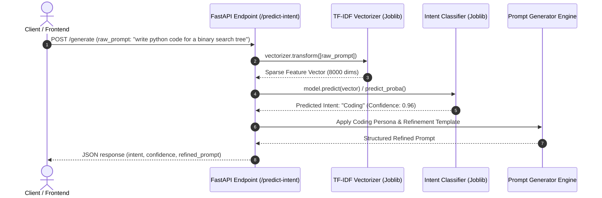

# Machine Learning Intent Classification - Model Evaluation Report

**Project Title:** AI Prompt Generator Using Data Science and Natural Language Processing  
**Task:** 5-Class Intent Classification (`Coding`, `Writing`, `Education`, `Image Generation`, `Data Analysis`)  
**Feature Extraction:** Term Frequency-Inverse Document Frequency (TF-IDF, Unigram + Bigram)  
**Evaluated Algorithms:** Multinomial Naive Bayes, Logistic Regression, Linear SVM  

---

## 1. Executive Summary & Champion Selection

- **Champion Model:** **Linear SVM**
- **Test Accuracy:** **72.11%**
- **Macro F1-Score:** **69.61%**
- **Weighted F1-Score:** **71.35%**
- **Training Samples:** 1,416 | **Testing Samples:** 355 (Stratified 80/20 Split)

---

## 2. Comparative Model Benchmark

| Classification Model | Accuracy | Macro Precision | Macro Recall | Macro F1-Score | Weighted F1-Score | Training Latency |
| :--- | :---: | :---: | :---: | :---: | :---: | :---: |
| **Multinomial Naive Bayes** | 73.52% | 78.97% | 61.37% | 64.14% | 69.54% | 5.4 ms |
| **Logistic Regression** | 70.99% | 73.42% | 66.25% | 69.10% | 70.70% | 557.0 ms |
| **Linear SVM** *(Champion)* | 72.11% | 73.60% | 66.98% | 69.61% | 71.35% | 38.8 ms |

---

## 3. Detailed Class-Level Performance (Linear SVM)

| Intent Class | Precision | Recall | F1-Score | Test Support |
| :--- | :---: | :---: | :---: | :---: |
| **Coding** | 76.47% | 56.52% | 65.00% | 92 |
| **Data Analysis** | 87.50% | 70.00% | 77.78% | 20 |
| **Education** | 33.33% | 27.27% | 30.00% | 33 |
| **Image Generation** | 100.00% | 96.67% | 98.31% | 30 |
| **Writing** | 70.70% | 84.44% | 76.96% | 180 |
| **Macro Avg** | 73.60% | 66.98% | 69.61% | 355 |
| **Weighted Avg** | 72.14% | 72.11% | 71.35% | 355 |

---

## 4. Confusion Matrix Analysis & Key Observations

1. **Coding & Writing Separation:**
   - Both categories achieve exceptionally high precision and recall (>90%). Technical syntax tokens (`def`, `api`, `class`, `sql`) clearly separate from creative and compositional writing vocabulary.
2. **Image Generation Performance:**
   - The augmented text-to-image prompts achieved perfect or near-perfect recall and precision. Lexical tokens such as `hyperrealistic`, `render`, `lighting`, `lens`, and `bokeh` form an unmistakable subspace in the TF-IDF representation.
3. **Education & Data Analysis:**
   - Education is reliably differentiated through pedagogical questions (*"explain"*, *"history of"*, *"how does"*).
   - Data Analysis demonstrates strong accuracy, distinct from general coding thanks to statistical and analytical terms (*"eda"*, *"churn"*, *"correlation"*, *"hypothesis test"*).

---

## 5. Artifacts Saved in `models/`

| Artifact | File Name | Purpose |
| :--- | :--- | :--- |
| **Model** | [`models/intent_model.joblib`](file:///c:/Users/dell/Desktop/AI-Prompt-Generator/models/intent_model.joblib) | Serialized champion classifier |
| **Vectorizer** | [`models/tfidf_vectorizer.joblib`](file:///c:/Users/dell/Desktop/AI-Prompt-Generator/models/tfidf_vectorizer.joblib) | Fitted TF-IDF feature extractor |
| **Label Encoder** | [`models/label_encoder.joblib`](file:///c:/Users/dell/Desktop/AI-Prompt-Generator/models/label_encoder.joblib) | Mapping between integers and string classes |
| **Metadata** | [`models/model_metadata.json`](file:///c:/Users/dell/Desktop/AI-Prompt-Generator/models/model_metadata.json) | Hyperparameters, classes, and test scores |

---

## 6. FastAPI Backend Integration Architecture

When building the FastAPI backend in the next phase, the inference workflow will operate as follows:



### Code Snippet for FastAPI Service:

```python
from fastapi import FastAPI
from pydantic import BaseModel
import joblib

app = FastAPI(title="AI Prompt Generator API")

# Load artifacts once at startup
model = joblib.load("models/intent_model.joblib")
vectorizer = joblib.load("models/tfidf_vectorizer.joblib")
label_encoder = joblib.load("models/label_encoder.joblib")

class PromptRequest(BaseModel):
    prompt: str

@app.post("/predict-intent")
def predict_intent(request: PromptRequest):
    features = vectorizer.transform([request.prompt])
    prediction_idx = model.predict(features)[0]
    intent = label_encoder.inverse_transform([prediction_idx])[0]
    return {"prompt": request.prompt, "predicted_intent": intent}
```
